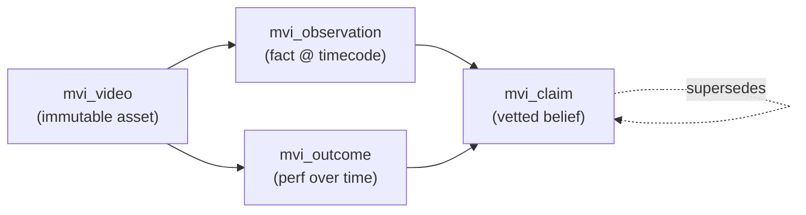

# video-intel — Source-Grounded Marketing Video Intelligence

A standalone service that turns a pile of marketing videos into a **vetted, queryable
institutional index**. It implements the essay's decisive principle —

> Raw media, extracted observations, vetted claims, outcomes, and the human cockpit
> must remain **separate** — each with permanent IDs and provenance.

…without dragging in the full 10-tool enterprise stack. Everything below runs on infra
this machine already operates: FastAPI, the shared Supabase hub, Obsidian, intel-node.

## The five separations (and where each lives)

| Layer | Essay concept | Store | Rule |
|---|---|---|---|
| Immutable media | `content_asset` | `mvi_video` (Supabase) + object storage / MyPassport path | never mutated; identified by file hash |
| Extracted observations | `observation` + `source_span` | `mvi_observation` (Supabase, pgvector) | every fact points to a **timecode** in a video |
| Vetted claims | `claim` | `mvi_claim` (Supabase) | supported/contradicted by observation IDs; `valid_from`/`valid_to`; `supersedes` |
| Outcomes | `outcome` | `mvi_outcome` (Supabase) | performance tied to video × platform × campaign, temporal |
| Analyst cockpit | Obsidian | `<vault>/Marketing-Videos/<slug>.md` | **generated from** Supabase; read-view, not truth |

## Object model (canonical, prefix `mvi_`)

Every object gets a permanent ID. Every observation carries: `video_id`, `t_start`/`t_end`
(provenance span), `kind` (hook | format | transcript | scene | claim_extract), `payload`
(jsonb), `embedding` (vector), `extracted_by` (agent/run), `created_at`.

Every claim carries: supporting + contradicting observation IDs, `confidence`,
`verification_status`, `valid_from`/`valid_to`, `supersedes_claim_id`.

## Service surface (FastAPI, matches Media Vault / MediaPoster stack)

| Route | Does |
|---|---|
| `GET /api/health` | required health endpoint (Supabase + vault reachability) |
| `POST /api/index` | register a video → hash → analyze (transcript/hook/format/scene/embed) → write `mvi_video` + `mvi_observation` → generate Obsidian note |
| `POST /api/outcome` | attach a performance datapoint to a video (platform, campaign, metric, value, ts) |
| `GET  /api/search` | structured + semantic retrieval over observations; returns videos + matching spans |
| `POST /api/claim` | assert/supersede a claim with supporting observation IDs |
| `POST /api/sync-obsidian` | regenerate vault notes from Supabase (truth → cockpit) |

## Registration to the "research institution"

The query surface is **intel-node :5580** (the user's central hub). video-intel registers
itself there so hub-level queries and other services can reach the index. Upgrade path to a
real external org = add row-level scoping + hosted endpoint + auth on the same schema.

## Retrieval

pgvector column on `mvi_observation.embedding`. One index, no separate vector DB to babysit.
Swap-able later (the essay's "Chroma initially, replaceable" — we just skip straight to
Postgres-native since the hub is already Postgres).

## What we deliberately did NOT build (and when to add it)

- **Graphiti / Neo4j temporal graph** — `mvi_claim.valid_from/valid_to/supersedes` covers
  "what did we believe in May vs July" for this domain. Add Graphiti only if cross-domain
  temporal reasoning becomes real.
- **Onyx / RAGFlow portal** — intel-node + `/api/search` is the portal. Add a dedicated
  portal only when non-technical users need it.
- **Temporal / LangGraph** — the pipeline is linear (index → analyze → write). Add durable
  workflow only when a step becomes business-critical and crash-sensitive.
- **Zotero / Readwise** — those are for papers, not marketing videos. Out of scope.
